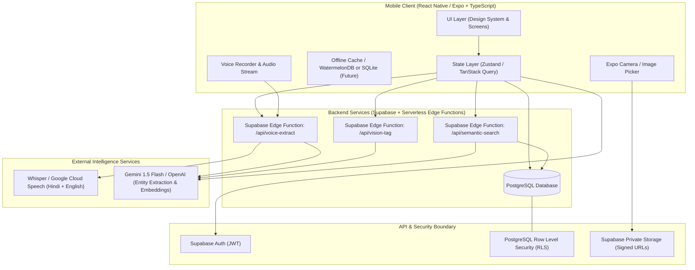
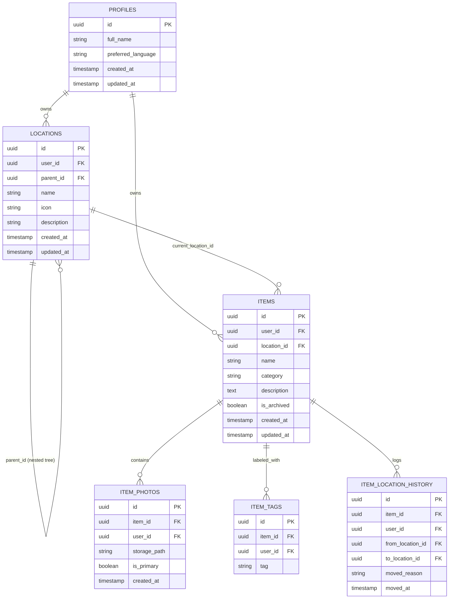

# Personal Belongings Finder (Memory & Inventory Assistant)
## Architectural Blueprint & Product Specification Document

---

## 1. Refined Product Requirements Document (PRD)

### 1.1 Executive Summary & Core Value Proposition
Human memory is associative and contextual, while conventional storage systems are strictly physical. People do not remember items as SKU codes or rigid database categories; they remember moments, containers, rooms, or approximate visual contexts (e.g., *"I put the spare passport inside the blue zipper pouch in the master bedroom cupboard"*).

**Personal Belongings Finder** bridges the gap between human memory and physical reality. It serves as an **AI-powered external memory bank** designed to make cataloging frictionless (via voice, camera, and quick-forms) and retrieval instantaneous (via exact, phonetic, and semantic natural-language search).

### 1.2 Target User Personas
1. **The Busy Professional / Family Manager**: Balances multiple properties, office drawers, household documents (insurance, deeds, passports), and family assets. Needs instant answers without rummaging.
2. **The Relocator / Organizer**: Moves houses or offices frequently; needs hierarchical box-and-shelf labeling with instant photo confirmation.
3. **The Multi-Generational Household**: Needs multi-language support (English, Hindi, Hinglish) and voice entry for elders who find manual typing tedious.

### 1.3 Functional Requirements Breakdown

| Module | Requirement | Priority | Notes / Acceptance Criteria |
| :--- | :--- | :--- | :--- |
| **Auth** | Email / Phone OTP Authentication | P0 | Supabase Auth with RLS, session persistence, biometrics support. |
| **Auth** | Profile & Privacy Controls | P0 | Complete data isolation; GDPR/DPDP-compliant account deletion. |
| **Cataloging** | Manual Item Entry | P0 | Name, category, hierarchical location, tags, notes, photo. |
| **Cataloging** | Voice-First Entry (Multilingual) | P0 | Audio capture → Speech-to-Text → LLM entity extraction (Item, Category, Path, Note) → Confirmation UI before saving. |
| **Cataloging** | Photo Entry & Visual Tagging | P1 | Camera capture or gallery picker (up to 2 photos per item) + AI vision suggestion for tags/categories (location remains user-confirmed). |
| **Locations** | Hierarchical Tree System | P0 | Arbitrary depth (e.g., Home → Bedroom → Wardrobe → Shelf 2 → Red Box). Dynamic path calculation. |
| **Locations** | Location Management | P0 | Create, rename, move, and nest locations; view all items stored within any node or subtree. |
| **Search** | Dual-Engine Search (Hybrid) | P0 | 1) Fast local/SQL lexical search (FTS & Trigram) for exact/partial names. 2) Semantic AI search for conceptual queries (*"travel papers"* → matches *"Passport"*). |
| **Search** | Location & Category Filtering | P0 | Filter by room/box or category chips with instant count badges. |
| **Audit** | Location History Tracking | P1 | Automated log whenever an item moves between locations, recording timestamp and previous path. |

---

## 2. System Architecture



### Architectural Principles:
1. **Zero Secret Leaks on Client**: Client holds only public anon keys. High-privilege operations, AI prompts, and speech-to-text API keys live exclusively within Supabase Edge Functions.
2. **Private-by-Default Storage**: Photos are stored in a private Supabase Storage bucket (`item-photos`). The mobile app fetches short-lived Signed URLs, preventing public exposure of sensitive household assets.
3. **Resilient Dual-Tier Search**:
   - **Tier 1 (Instant Database Search)**: Uses PostgreSQL Full-Text Search (`tsvector`) and trigram fuzzy matching (`pg_trgm`). Runs in milliseconds without API costs and works even under poor connectivity.
   - **Tier 2 (AI Semantic Search)**: Translates colloquial queries into semantic embeddings or structured filters to handle conceptual queries (*"where are my car registration documents?"*).

---

## 3. Database Schema & Row Level Security (RLS)

### 3.1 Entity Relationship Diagram



### 3.2 SQL Schema & Policies (PostgreSQL / Supabase DDL)

```sql
-- Enable necessary extensions
CREATE EXTENSION IF NOT EXISTS "uuid-ossp";
CREATE EXTENSION IF NOT EXISTS "pg_trgm";

-- 1. Profiles Table
CREATE TABLE public.profiles (
    id UUID PRIMARY KEY REFERENCES auth.users(id) ON DELETE CASCADE,
    full_name TEXT,
    avatar_url TEXT,
    preferred_language TEXT DEFAULT 'en',
    created_at TIMESTAMPTZ DEFAULT NOW(),
    updated_at TIMESTAMPTZ DEFAULT NOW()
);

-- 2. Locations Table (Self-referencing tree)
CREATE TABLE public.locations (
    id UUID PRIMARY KEY DEFAULT uuid_generate_v4(),
    user_id UUID NOT NULL REFERENCES auth.users(id) ON DELETE CASCADE,
    parent_id UUID REFERENCES public.locations(id) ON DELETE CASCADE,
    name TEXT NOT NULL,
    icon TEXT DEFAULT 'folder-outline',
    description TEXT,
    created_at TIMESTAMPTZ DEFAULT NOW(),
    updated_at TIMESTAMPTZ DEFAULT NOW()
);

CREATE INDEX idx_locations_user_id ON public.locations(user_id);
CREATE INDEX idx_locations_parent_id ON public.locations(parent_id);

-- 3. Items Table
CREATE TABLE public.items (
    id UUID PRIMARY KEY DEFAULT uuid_generate_v4(),
    user_id UUID NOT NULL REFERENCES auth.users(id) ON DELETE CASCADE,
    location_id UUID NOT NULL REFERENCES public.locations(id) ON DELETE RESTRICT,
    name TEXT NOT NULL,
    category TEXT NOT NULL DEFAULT 'General',
    description TEXT,
    is_archived BOOLEAN DEFAULT FALSE,
    search_vector TSVECTOR GENERATED ALWAYS AS (
        to_tsvector('english', coalesce(name, '') || ' ' || coalesce(category, '') || ' ' || coalesce(description, ''))
    ) STORED,
    created_at TIMESTAMPTZ DEFAULT NOW(),
    updated_at TIMESTAMPTZ DEFAULT NOW()
);

CREATE INDEX idx_items_user_id ON public.items(user_id);
CREATE INDEX idx_items_location_id ON public.items(location_id);
CREATE INDEX idx_items_search_vector ON public.items USING GIN(search_vector);
CREATE INDEX idx_items_name_trgm ON public.items USING GIN(name gin_trgm_ops);

-- 4. Item Photos Table
CREATE TABLE public.item_photos (
    id UUID PRIMARY KEY DEFAULT uuid_generate_v4(),
    item_id UUID NOT NULL REFERENCES public.items(id) ON DELETE CASCADE,
    user_id UUID NOT NULL REFERENCES auth.users(id) ON DELETE CASCADE,
    storage_path TEXT NOT NULL,
    is_primary BOOLEAN DEFAULT FALSE,
    created_at TIMESTAMPTZ DEFAULT NOW()
);

CREATE INDEX idx_item_photos_item_id ON public.item_photos(item_id);

-- 5. Item Tags Table
CREATE TABLE public.item_tags (
    id UUID PRIMARY KEY DEFAULT uuid_generate_v4(),
    item_id UUID NOT NULL REFERENCES public.items(id) ON DELETE CASCADE,
    user_id UUID NOT NULL REFERENCES auth.users(id) ON DELETE CASCADE,
    tag TEXT NOT NULL,
    created_at TIMESTAMPTZ DEFAULT NOW()
);

CREATE INDEX idx_item_tags_item_id ON public.item_tags(item_id);
CREATE INDEX idx_item_tags_tag ON public.item_tags(tag);

-- 6. Item Location History Table
CREATE TABLE public.item_location_history (
    id UUID PRIMARY KEY DEFAULT uuid_generate_v4(),
    item_id UUID NOT NULL REFERENCES public.items(id) ON DELETE CASCADE,
    user_id UUID NOT NULL REFERENCES auth.users(id) ON DELETE CASCADE,
    from_location_id UUID REFERENCES public.locations(id) ON DELETE SET NULL,
    to_location_id UUID REFERENCES public.locations(id) ON DELETE SET NULL,
    notes TEXT,
    moved_at TIMESTAMPTZ DEFAULT NOW()
);

CREATE INDEX idx_item_history_item_id ON public.item_location_history(item_id);

-- Recursive Function to get Full Location Path
CREATE OR REPLACE FUNCTION get_location_path(loc_id UUID)
RETURNS TEXT AS $$
WITH RECURSIVE location_hierarchy AS (
    SELECT id, parent_id, name, 1 as depth
    FROM public.locations
    WHERE id = loc_id
    UNION ALL
    SELECT p.id, p.parent_id, p.name, lh.depth + 1
    FROM public.locations p
    INNER JOIN location_hierarchy lh ON lh.parent_id = p.id
)
SELECT string_agg(name, ' → ' ORDER BY depth DESC)
FROM location_hierarchy;
$$ LANGUAGE sql STABLE;

-- ROW LEVEL SECURITY (RLS) POLICIES
ALTER TABLE public.profiles ENABLE ROW LEVEL SECURITY;
ALTER TABLE public.locations ENABLE ROW LEVEL SECURITY;
ALTER TABLE public.items ENABLE ROW LEVEL SECURITY;
ALTER TABLE public.item_photos ENABLE ROW LEVEL SECURITY;
ALTER TABLE public.item_tags ENABLE ROW LEVEL SECURITY;
ALTER TABLE public.item_location_history ENABLE ROW LEVEL SECURITY;

-- Profiles Policy
CREATE POLICY "Users can manage own profile" ON public.profiles
    FOR ALL USING (auth.uid() = id);

-- Locations Policy
CREATE POLICY "Users can manage own locations" ON public.locations
    FOR ALL USING (auth.uid() = user_id);

-- Items Policy
CREATE POLICY "Users can manage own items" ON public.items
    FOR ALL USING (auth.uid() = user_id);

-- Item Photos Policy
CREATE POLICY "Users can manage own item photos" ON public.item_photos
    FOR ALL USING (auth.uid() = user_id);

-- Item Tags Policy
CREATE POLICY "Users can manage own item tags" ON public.item_tags
    FOR ALL USING (auth.uid() = user_id);

-- Item History Policy
CREATE POLICY "Users can view own item history" ON public.item_location_history
    FOR ALL USING (auth.uid() = user_id);
```

---

## 4. Mobile Application Screen & Navigation Plan

### 4.1 Navigation Architecture (React Navigation with Expo)

```
RootNavigator
│
├── AuthStack (Unauthenticated)
│   ├── WelcomeScreen (Value proposition carousel)
│   ├── LoginScreen (Email/Password or OTP)
│   ├── RegisterScreen
│   └── ForgotPasswordScreen
│
└── AppTabs (Authenticated Main Stack)
    ├── Tab 1: HomeStack
    │   ├── HomeScreen (Prominent Search, Quick Add, Recent Items, Frequent Locations)
    │   ├── ItemDetailScreen (View item, photo carousel, full location path, action buttons)
    │   ├── EditItemScreen (Modify details, move location, update photos)
    │   └── MoveItemModal (Quick location picker + history notes)
    │
    ├── Tab 2: SearchStack
    │   ├── SearchScreen (Live filter, voice search trigger, category/tag chips, results feed)
    │   └── SearchResultsDetailScreen
    │
    ├── Tab 3: AddStack (Modal / Central Tab)
    │   ├── AddBelongingChoiceModal (Manual, Voice, Camera)
    │   ├── ManualAddScreen (Full form with nested location selector)
    │   ├── VoiceAddModal (Speech recording → live transcription → AI extraction preview)
    │   └── CameraAddScreen (Capture photo → AI object suggestion → location confirm)
    │
    ├── Tab 4: LocationsStack
    │   ├── LocationsHierarchyScreen (Interactive expandable folder tree)
    │   ├── LocationDetailScreen (List of all items stored here + child sub-locations)
    │   ├── CreateLocationModal (Name, parent picker, custom icon)
    │   └── EditLocationScreen
    │
    └── Tab 5: ProfileStack
        ├── ProfileScreen (User info, storage quota, language selector)
        ├── ExportDataScreen (JSON / CSV backup export)
        ├── SecuritySettingsScreen (Biometrics toggle, change password)
        └── DeleteAccountScreen (Compliance hard-delete)
```

### 4.2 Core Screen UI/UX Specifications

1. **Home Screen**:
   - Top Header: Personalized greeting + Profile avatar.
   - Hero Section: Large rounded Search Bar with integrated Mic and Camera icons.
   - Quick Action Bar: 3 high-contrast pill buttons: *+ Quick Add*, *🎙️ Voice Note*, *📸 Snap Item*.
   - Section 1: *Recently Stored Belongings* (Horizontal card carousel with thumbnail, item name, and top-level location).
   - Section 2: *Browse by Location* (Grid of top locations: Home, Office, Storage, Vehicle with item counts).

2. **Smart Add Modal (Voice / Camera / Manual)**:
   - Voice Entry Flow: Tap mic → User speaks (*"I kept my spare car keys in the entrance drawer inside the wooden box"*) → Waveform animation → Review parsed fields:
     - **Item Name**: Spare Car Keys
     - **Category**: Vehicle / Keys
     - **Suggested Path**: Home → Entrance → Drawer → Wooden Box
     - User clicks **[Confirm & Save]** or touches any field to adjust before committing.

3. **Item Detail Screen**:
   - Top visual banner with 1–2 photos (tap to expand with zoom).
   - Breadcrumb badge: `Home` > `Bedroom` > `Cupboard` > `Drawer 2` > `Blue Folder` (tap to view other items in that folder).
   - Description, keywords/tags, date added, and *View Location History* link.
   - Primary action buttons: *[Move Location]*, *[Edit Details]*, *[Archive / Delete]*.

---

## 5. Phase-Wise Development & Testing Plan

| Phase | Core Deliverables | Testing & Verification Strategy | Estimated Timeline |
| :--- | :--- | :--- | :--- |
| **Phase 1: Foundation** | • Expo TypeScript setup with strict typing<br>• Supabase client integration & Auth flow<br>• Theme design system (Light/Dark tokens)<br>• Bottom tab & stack navigation | • Auth unit tests (Register, Login, SignOut)<br>• Session persistence on app restart<br>• Device safe-area and responsive layout test | Milestone 1 |
| **Phase 2: Core Inventory & Locations** | • Database migrations & RLS policies<br>• Hierarchical location management (CRUD)<br>• Manual item entry with photo upload (Supabase Storage)<br>• Item detail & edit screens with recursive location paths | • Database RLS leak tests (User A cannot query User B)<br>• Image upload & signed URL generation test<br>• Parent-child location cycle prevention test | Milestone 2 |
| **Phase 3: Hybrid Search Engine** | • PostgreSQL Full-Text Search (FTS)<br>• Trigram fuzzy matching for typos<br>• Category and Location faceted filters<br>• Search UI with debounced instant querying | • Search latency test (< 150ms target)<br>• Misspelling resilience test (*"pasport"* finds *"Passport"*); Location filter validation | Milestone 3 |
| **Phase 4: Smart Multilingual Input & AI** | • Speech-to-text integration (Expo AV + Whisper/Google STT)<br>• Supabase Edge Function for LLM extraction (English/Hindi)<br>• Visual tag suggestion using Gemini Flash Vision<br>• Confirmation UI before DB commit | • End-to-end voice query accuracy test in English & Hindi<br>• Vision API object tag relevance test<br>• Graceful fallback to manual entry on network failure | Milestone 4 |
| **Phase 5: Audit & History** | • Automated location transition logging (`item_location_history`)<br>• Location history timeline UI<br>• Data export (JSON/CSV) | • Integrity test: moving item updates history correctly<br>• CSV/JSON export validation | Milestone 5 |
| **Phase 6: Production Hardening** | • Security audit (no client secret leaks, signed photo URLs)<br>• Performance profiling (FlatList memory, image caching)<br>• Production builds (EAS Build for Android APK & iOS IPA) | • Static code analysis & dependency audit<br>• Cold start time < 2.0s benchmark<br>• End-to-end regression test suite | Milestone 6 |

---

## 6. Technical Risks, Dependencies & Mitigation Matrix

| Risk / Dependency | Impact | Probability | Mitigation Strategy |
| :--- | :--- | :--- | :--- |
| **1. Unreliable Mobile Connectivity for AI/Voice** | High | Medium | Store speech audio locally if network fails; fallback to standard manual entry; keep local PostgreSQL search completely independent of AI. |
| **2. Hindi/English Accent & Code-Mixing (Hinglish)** | Medium | High | Use whisper-large-v3 or Google Cloud Speech with multi-language hinting (`hi-IN`, `en-IN`), followed by an LLM prompt trained on Indian code-mixed household terminology (*"almari"*, *"dabba"*, *"diwan"*, *"godrej"*). |
| **3. Recursive Location Tree Performance** | Medium | Low | Use PostgreSQL recursive CTEs (`get_location_path`) in database views or functions rather than doing multiple round-trips from the mobile client. |
| **4. Cloud Storage Photo Costs & Exposure** | High | Low | Restrict to 2 photos per item; client-side resize and compress to WebP (< 300KB) before upload; use Supabase private storage with short-lived signed URLs. |
| **5. Accidental Infinite Cycles in Locations** | High | Low | Add database trigger constraint preventing a location from having its own descendant as a parent. |
